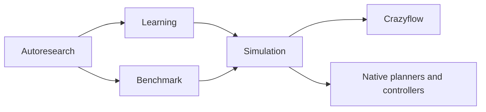

# Drone Playground

Drone Playground is a JAX quadrotor research platform built on Crazyflow. It
supports Tracking, Racing, Static Obstacle Avoidance, and Dynamic Obstacle
Avoidance with BPTT, SHAC, and PPO. Perception policies use D435i depth or MID360
LiDAR; native EGO-Planner and SUPER run through independent ROS workers.

Use the [Command Builder](docs/command-builder.html) to generate Train, Play,
and Benchmark commands. [Release evidence](docs/validation.md) separates actual
execution checks from policy convergence. This development version has not
completed release acceptance.

## Start

Install [Pixi](https://pixi.sh), then run from this checkout:

```bash
pixi install --locked
pixi run autoresearch setup
pixi run train experiment=tracking learning=bptt seed=0
pixi run play experiment=tracking learning=bptt checkpoint=latest
pixi run benchmark experiment=tracking learning=bptt checkpoint=latest
```

Training runs through Autoresearch Gym and writes its run directory to the final
summary. Navigation training samples independent obstacle layouts; fixed S/D
maps are used only for evaluation.
The [Autoresearch Dashboard](docs/autoresearch.md#training-visuals) can display
optional live MuJoCo frames and sampled trajectories. New Autoresearch runs also
save an animated WebP of the final training Rollout fragment, even if visualization
was Off during training.

```bash
pixi run train experiment=oa_static_depth learning=ppo seed=0
pixi run train experiment=oa_dynamic_lidar learning=shac seed=0
pixi run play experiment=oa_static_depth learning=ppo checkpoint=best \
  scene=S01 'benchmark.scenes=[S01]' simulation.num_envs=1
```

`latest` selects the latest published update in the newest compatible run.
`best` selects its recorded highest mean Episode Reward when optional selection
is enabled; otherwise it falls back to latest and records that fallback. An
explicit Orbax model directory selects a particular policy. Only Orbax
checkpoints can be loaded or resumed by this version.

See [installation](docs/installation.md) for GPU, CPU, acados, and ROS setup;
[training](docs/training.md) for budgets and resumption; and
[Autoresearch](docs/autoresearch.md) for controlled candidate search.

## Architecture



Learning owns updates, optimizer state, and checkpoints. Simulation owns tasks,
geometry, sensors, methods, physical execution, and replay. Benchmark owns fixed
flight cases, measurements, and reports. Training saves numbered checkpoints;
optional fixed-reward evaluation for Best runs inside Learning, not Benchmark.

`play` runs a selected flight for inspection and optional replay. `benchmark`
runs a declared suite of paired flight cases for every method and produces
complete comparison reports. Both use the same Simulation execution path.

Benchmark reports success rate over every episode and flight-quality metrics
over successful episodes, with contributing counts. It follows FlightBench's
speed, acceleration, jerk, and curvature definitions and adds AvoidBench-inspired
static path excess and Traversability. See the [measurement protocol](docs/benchmark.md).

## Supported combinations

| Task | Policy observation | Algorithms | Native methods |
|---|---|---|---|
| Tracking | State | BPTT, SHAC, PPO | Sampling MPC, Attitude MPC, Full-State NMPC |
| Racing | State | BPTT, SHAC, PPO | Three general trackers, Racing MPCC, Perception-Aware MPC (experimental) |
| Static OA | Depth or LiDAR | BPTT, SHAC, PPO | EGO/SUPER + generic trajectory tracker |
| Dynamic OA | Depth or LiDAR | BPTT, SHAC, PPO | EGO/SUPER + generic trajectory tracker |

BPTT and SHAC can use native Crazyflow derivatives, LOTF, or point-mass-lag
backward dynamics. The forward plant remains Crazyflow. The builder selects
compatible action and loss settings. The core suite retains 230 tested historical
commands; the optional Forest/Maze/Dense MJCF suite and capability-compatible
controllers extend the builder to **550 configurations** (42 Train, 380 Play,
128 Benchmark). See [validation](docs/validation.md) for the separate runtime
and configuration evidence. New physics backends and learning libraries remain
outside this release.

The [Racing MPC guide](docs/racing-optimization.md) documents the acados MPCC
and JAX perception-cost controller. The original RPG Time-Optimal adapter and
ROS1/ACADO PAMPC are deliberately excluded from `main`: the former has not
passed Crazyflow closed-loop acceptance, and the latter is not integrated.
The [controller compatibility decision](docs/adr/0033-controller-compatibility-and-reference-tracking.md)
distinguishes task-specific Racing controllers from reusable trajectory
trackers; the new RPS98-inspired Full-State NMPC tracks planned paths with
Crazyflow's physical BodyRate input.
The [visualization guide](docs/visualization.md) keeps Autoresearch as the
training dashboard, adds native-MJCF browser replay, and retains RScope for
sensor and planner overlays.

Use `randomization=nominal`, `randomization=dynamics`, or
`randomization=sim2real` with training commands. The optional presets use
Crazyflow physical parameter randomization, actuation delay, sensor latency,
and gust forces; pixel and LiDAR-ray noise are not currently implemented.

## Development

```bash
pixi run lint
JAX_PLATFORMS=cpu pixi run test
pixi run build
```

The [documentation index](docs/README.md), [domain glossary](GLOSSARY.md), and
[architecture decisions](docs/adr/0026-training-benchmark-release-separation.md)
describe the current interfaces. Runtime data stay under ignored `results/`;
historical weights and reports retain their original source and protocol.
Upstream licenses and asset attribution are distributed with the package.
